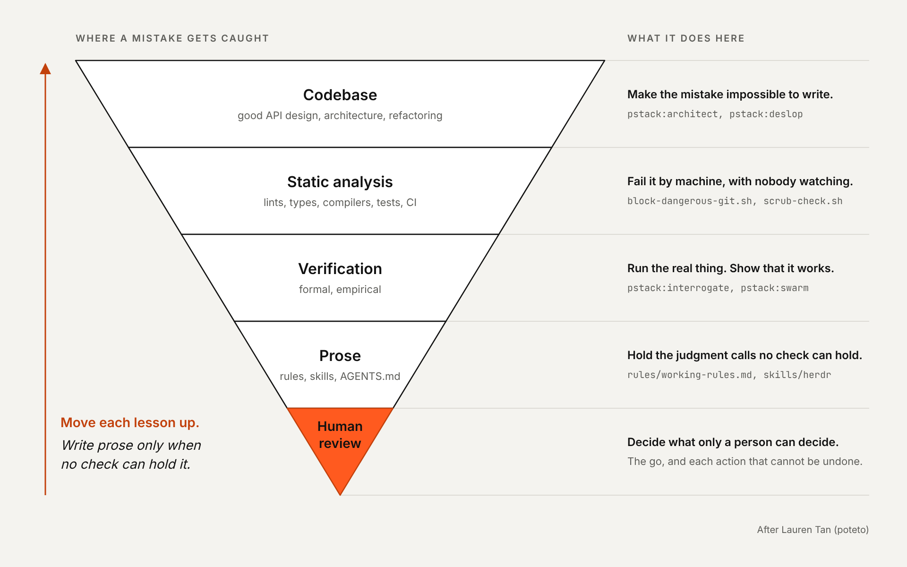

# Komputa agent practice

This repo holds the working practice that Komputa uses to build software
with coding agents. The default is one Claude Code session that plans, builds
and merges one pull request at a time. An agent that did not write the change
verifies each pull request that changes behaviour. The repo gives you the
rules, the hooks that refuse what must never run, and the evidence behind
each rule.

It also holds a [herdr](https://releases.herdr.dev) skill and worker
templates, for the times when you want a worker in a pane that you can watch.
[pstack](https://github.com/cursor/plugins/tree/main/pstack) sets the models
and the playbooks.

Until 10 November 2026 the practice ran unattended leads and workers. The
scripts for that are in `archive/herdr/`, and nothing runs them.
`docs/framework-evidence.md` says why: on one program, 33 of 42 fix pull
requests repaired tests and tools, not the product. It also says what is not
proved yet, and how the one-session period is measured. A script comes back
from the archive only on evidence.

## The quality funnel



This funnel is the core of the practice. Catch each mistake at the highest
layer that can hold it, and keep the operator's review for what only a
person can decide. The rule is in `rules/working-rules.md`.

## Who this is for

You run Claude Code on a real codebase. You want small changes, tests that
follow risk, and each change verified by an agent that did not write it. You
also want to know what each rule costs. Now and then you may want a worker
in a pane that you can watch.

You need these tools:

- Claude Code.
- pstack for Claude Code.
- Linux with `bash` and `jq`.
- herdr, only for workers: `herdr-app` (the window) and `hc` (herdr-core,
  which runs the terminals and the agents in them).

## How the pieces fit

In one session, the session is the lead and the owner, and the verifier is
one subagent. The table below is the form with workers: one program then has
four kinds of part.

| Part | What it is | What it does |
|------|------------|--------------|
| Lead | Your own Claude Code session, in pstack's `poteto-mode` | Plans the work, writes one brief for each pull request, starts the owners, reads their reports and merges. It never writes the code that it verifies. |
| Owner | An `hc` worker in its own pane, started from `skills/herdr/assets/templates/owner.md` | Builds one pull request in its own git worktree, pushes its branch, drives CI to green, writes a report file and sends the lead one short message. |
| Verifier lane | A short Claude Code `Agent` subagent (`pstack:swarm`, `pstack:interrogate`) | Tries to break the owner's change on the real artifact. A finding counts only when a run shows it. |
| Trail | A `show-me-your-work` TSV file, one for each owner | Records each decision with its reason and evidence, so a person can review the program after they step away. |

A long owner runs as an `hc`
worker, so you can watch and steer it. A short fan-out runs as an `Agent`
subagent, and pstack sets its model. Never run the same work both ways.

`rules/working-rules.md` holds the rules for one session. It opens with what
success is, and it makes the session act without waiting for you on reversible
work: it applies a default to a question about the work and reports the default.
`rules/leadonly-rules.md` adds the rules for a lead that starts workers: the
lead answers worker dialogs itself.
It pauses only for an action that cannot be undone, such as a deploy or a
message to people.

## Repo layout

| Path | Contents |
|------|----------|
| `copier.yml`, `template/` | The project template: a Copier template that starts a repo with the house standards and keeps it current (the gate, the build checks, the PR template, the seeded `CLAUDE.md`). Copier reads `copier.yml` from the repo root. |
| `standards/` | The template's own tests and Python project, and its README. It was the `project-standards` repo; its history is kept. |
| `instances/example.yml` | What an environment file holds: the answers your repos share that this repo must not (for example the secret command). Keep your own copy outside the repo. |
| `skills/house-*/` | The house rules for how code is shaped and run: `house-architecture`, the language skills (`house-dotnet`, `house-python`, `house-typescript`, `house-shell`), `house-otel` and `house-delivery`. Each rule holds with or without an agent framework. |
| `skills/standards-feedback/` | Turns review findings into changes to the house rules, or into a check in the template, so a mistake is fixed where it starts. |
| `skills/herdr/SKILL.md` | The herdr skill: when to use a worker, how to brief, start, show, wait for, replace and clean up one. |
| `skills/herdr/assets/templates/` | `hc` worker templates: `owner`, `implementer`, `fixer` and `reviewer`. |
| `archive/herdr/` | The scripts, systemd units and tests that ran unattended leads and workers, archived on 10 November 2026. No check covers them. `archive/README.md` has the detail. |
| `skills/herdr/evals/trigger.json` | Queries that must, and must not, trigger the skill. |
| `rules/working-rules.md` | Rules to copy into your global `~/.claude/CLAUDE.md`. |
| `rules/leadonly-rules.md` | Rules for a lead that starts workers. Not loaded by default. |
| `docs/model-selection.md` | How each agent's model is chosen: the role lines and the move-up rule. |
| `docs/quality-funnel.png` | The quality funnel picture. `docs/quality-funnel.html` is its source. |
| `docs/framework-evidence.md` | What one program built by this practice caught and what it cost, the trade-off of each change since, and how the next period is measured. |
| `scripts/program-scorecard.py` | Reads the merged pull requests of a repo from git and prints the scorecard that the evidence page uses. |
| `docs/context-economics.md` | Where the tokens go when agents run as workers: what we measured on a real project, what we learned, and why the budget and wait rules say what they say. |
| `hooks/block-secret-write.sh` | A Claude Code `PreToolUse` hook for Write and Edit (and Codex `apply_patch`). It refuses content that matches a secret pattern, and names the machine's secret tool from `HOOK_SECRET_TOOL`. |
| `hooks/block-credential-read.sh` | A Claude Code `PreToolUse` hook for Read and Bash. It refuses reading a credential file (SSH keys, `.netrc`, `.env`, the Claude credentials); counts and key names pass. |
| `hooks/hooks.test.sh` | Tests for the secret and credential hooks, with hostile payloads. |
| `hooks/gates.json` | The `PreToolUse` entries that register these hooks in `~/.claude/settings.json`. |
| `hooks/check-live.sh` | Compares each hook that `~/.claude/settings.json` registers with its copy here, since the live hooks are plain copies. |
| `hooks/block-dangerous-git.sh` | A Claude Code `PreToolUse` hook for Bash. It refuses destructive git commands, every forced push except a pinned lease, and a remote branch delete that would lose commits. |
| `hooks/block-dangerous-git.test.sh` | Tests for the hook. |
| `hooks/block-destructive-delete.sh` | A Claude Code `PreToolUse` hook for Bash. It refuses deletes that cannot be undone: a forge repo, project or org, a wiki space, and a recursive `rm` of another checkout, a folder directly under home or another session's tmp folder. |
| `hooks/block-destructive-delete.test.sh` | Tests for the delete hook, with its hostile inputs. |
| `hooks/block-operator-screen.sh` | A Claude Code `PreToolUse` hook for Bash and the `claude-in-chrome` tools. In a worker session only (`HERDR_WORKER=1`), it refuses commands that open the operator's browser, a browser without `--headless`, and every `claude-in-chrome` tool. |
| `hooks/block-operator-screen.test.sh` | Tests for the hook. |
| `scripts/check.sh` | Runs every check in this repo. CI (`.github/workflows/check.yml`) runs the same command. |
| `scripts/scrub-check.sh` | The check that keeps private items out of this repo. |

## Install

1. Install pstack for Claude Code. Follow the README of the
   [Claude Code port](https://github.com/michael-denyer/pstack-claude).
2. Run `/pstack:setup-pstack` in Claude Code. It writes
   `~/.claude/pstack-models.md`, which sets the model for each pstack role.
   A worker runs on the model that its role line names.
3. Install herdr from [releases.herdr.dev](https://releases.herdr.dev).
4. Read the publisher's own guides. Our skill adds rules on top of them.

	```sh
	hc --skill
	herdr-app --skill
	```

5. Clone this repo, then copy the skill and the templates into place:

	```sh
	git clone <repo-url> komputa-practice
	cd komputa-practice
	mkdir -p ~/.claude/skills ~/.config/herdr-core/templates
	cp -r skills/herdr ~/.claude/skills/
	cp skills/herdr/assets/templates/*.md ~/.config/herdr-core/templates/
	```

6. Add the rules from `rules/working-rules.md` to your global
   `~/.claude/CLAUDE.md`. Change "the operator" to suit your own file.
7. Copy `hooks/block-dangerous-git.sh`, `hooks/block-destructive-delete.sh` and
   `hooks/block-operator-screen.sh`
   to `~/.claude/hooks/`. Register each one in `~/.claude/settings.json` as a
   `PreToolUse` hook with the matcher `Bash` and `"onFailure": "block"`.
   Without `onFailure`, a hook that cannot start (a lost exec bit, a missing
   file) only logs an error, and the call runs. The hooks need `jq`.

	```json
	{ "matcher": "Bash", "hooks": [{ "type": "command", "command": "~/.claude/hooks/block-dangerous-git.sh", "onFailure": "block" }] },
	{ "matcher": "Bash", "hooks": [{ "type": "command", "command": "~/.claude/hooks/block-destructive-delete.sh", "onFailure": "block" }] },
	{ "matcher": "Bash|mcp__claude-in-chrome__.*", "hooks": [{ "type": "command", "command": "~/.claude/hooks/block-operator-screen.sh", "onFailure": "block" }] }
	```
   The last hook, `hooks/block-operator-screen.sh`, acts only in a worker
   session (one that has `HERDR_WORKER=1`). It refuses commands that
   open the operator's browser and every `claude-in-chrome` tool.
8. Start Claude Code inside a herdr pane, then ask it to start a worker.
   The skill triggers on requests such as "start an owner worker for PR 3
   that babysits its own CI".

## Use it on your machine

The install steps above copy the files. A copy drifts when this repo
changes. To use this checkout as the one source, link to it instead, so a
`git pull` updates the skill, the hook and the rules at once.

1. Clone the repo to a fixed path. The import in step 4 names this path.

	```sh
	git clone <repo-url> ~/Code/komputa-practice
	```

2. Link the herdr skill into your
   [skillshare](https://github.com/runkids/skillshare) source under the
   name `herdr`, then sync. Each target that includes `herdr` then reads
   this checkout:

	```sh
	for s in ~/Code/komputa-practice/skills/*/; do
	  skillshare link -g "$s" --name "$(basename "$s")" --enable
	done
	skillshare sync -g
	```

   Without skillshare, link the folder by hand:
   `ln -s ~/Code/komputa-practice/skills/herdr ~/.claude/skills/herdr`.
3. Link the two hooks, then register them in `~/.claude/settings.json` as
   in step 7 of the install:

	```sh
	mkdir -p ~/.claude/hooks
	ln -s ~/Code/komputa-practice/hooks/block-dangerous-git.sh ~/.claude/hooks/
	ln -s ~/Code/komputa-practice/hooks/block-destructive-delete.sh ~/.claude/hooks/
	```

4. Import the rules. Put this line, alone on its line, in your global
   `~/.claude/CLAUDE.md`. Claude Code loads an import in that file without
   asking:

	```text
	@~/Code/komputa-practice/rules/working-rules.md
	```

   Say in your own `CLAUDE.md` who "the operator" is. A tool that cannot
   read `@` imports, such as Codex CLI, needs the file inlined into its own
   instructions. Inline it again after each pull that changes `rules/`.
5. Check the result. The skill path must be inside the checkout, the git
   hook must refuse a plain forced push, and the delete hook must refuse a
   repo delete:

	```sh
	readlink -f ~/.claude/skills/herdr/SKILL.md
	jq -nc '{tool_name:"Bash",tool_input:{command:"git push --force origin main"}}' \
		| ~/.claude/hooks/block-dangerous-git.sh; echo "exit $?"
	jq -nc '{tool_name:"Bash",tool_input:{command:"gh repo delete o/r --yes"}}' \
		| ~/.claude/hooks/block-destructive-delete.sh; echo "exit $?"
	```

   Each hook prints its reason and exits 2.

## Test

Run every check: the scrub check, shellcheck, shfmt, ruff and the shell
tests. You need `uv` and `jq`.

```sh
scripts/check.sh
```

The command finds scripts and tests from git, so a new one needs no edit.

## Docs site

A documentation site renders the pages in `site/`, four repo files
(`docs/model-selection.md`, `docs/context-economics.md`,
`docs/framework-evidence.md`, `rules/working-rules.md`) and a hooks reference that
`scripts/docs-reference.sh` writes from each hook's header comment. The
repo stays the one source. The site is built with
[Blume](https://useblume.dev).

Run it:

```sh
npm ci --ignore-scripts
npm run docs:build     # writes .site/, then builds dist/
npm run docs:check     # blume validate: fails on a broken internal link
npm run docs:smoke     # starts dist/server, checks llms.txt, a Markdown copy, MCP search and every image
npm run docs:dev       # live preview on http://localhost:4321
```

`package.json` pins `@astrojs/react` to 7.0.1 with an `overrides` entry,
because a plain install of Blume 2.2.6 did not finish in 100 seconds without
it (ADR 0040 in herdr-projects has the record). Remove the entry when a
Blume release drops the need, and check that `npm ci` still finishes fast.

It publishes only what `scripts/docs-prepare.mjs` copies into `.site/`.
It does not publish `docs/handoffs/`, `.audit/` or any other path.

The build uses Blume's Node adapter, so the MCP search tool runs at `/mcp`.
A static build would keep the pages, search in the browser, `llms.txt` and
the Markdown copies, and lose the MCP search tool. No host or domain is
chosen yet. A host for the full site must run `node dist/server/entry.mjs`.

## Contribute

This repo is public, so each commit and each push goes through
`scripts/scrub-check.sh`. The check refuses home paths, private IP
addresses, email addresses, secret-tool calls, internal forge URLs, API-key
shapes and homelab host names. It also refuses each entry of a denylist
that lives outside the repo, so the denylist never names its items in
public.

1. Turn on the hooks:

	```sh
	git config core.hooksPath .githooks
	```

2. Create the denylist at `~/.config/komputa/public-denylist.txt`. Put one
   private item on each line. The check matches each line as text, without
   case. A line that starts with `#` is a comment. To use another path, set
   `SCRUB_DENYLIST`.
3. Run the check and its tests:

	```sh
	scripts/scrub-check.sh
	scripts/tests/scrub-check.test.sh
	```

The check prints the file, the line and the kind of each item, never the
item itself. Replace each item with a neutral placeholder, such as
`<home>`, `<forge-url>` or `<secret-tool>`, and keep the meaning of the
text. A binary file fails the check until a person reads it and adds its
path to `.scrub-binary-ok`.

## Credits

- [pstack](https://github.com/cursor/plugins/tree/main/pstack) is Lauren
  Tan's skill stack, under the MIT license. The playbooks, the model roles,
  `poteto-mode`, `swarm`, `interrogate` and `show-me-your-work` all come
  from pstack.
- The [Claude Code port of pstack](https://github.com/michael-denyer/pstack-claude)
  is by Michael Denyer.
- `hooks/block-dangerous-git.sh` starts from Matt Pocock's git-guardrails
  skill in [mattpocock/skills](https://github.com/mattpocock/skills), under
  the MIT license. We removed its block on a plain `git push` and added the
  pinned-lease rule for forced pushes.
- The quality funnel is our own drawing of a funnel by Lauren Tan (poteto).
- [herdr](https://releases.herdr.dev) provides `herdr-app` and `hc`. Our
  skill adds rules on top of herdr's own `hc --skill` and
  `herdr-app --skill` guides.

The rest of this repo is Komputa's own work, under the MIT license in
`LICENSE`.
